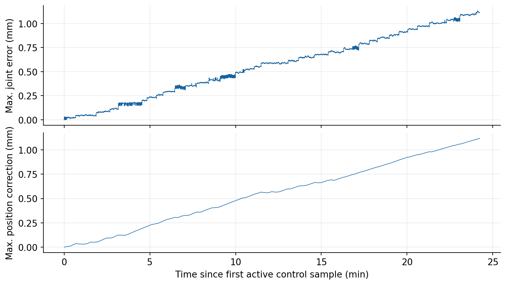
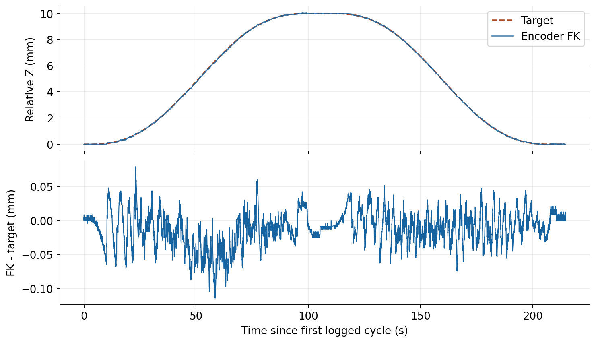
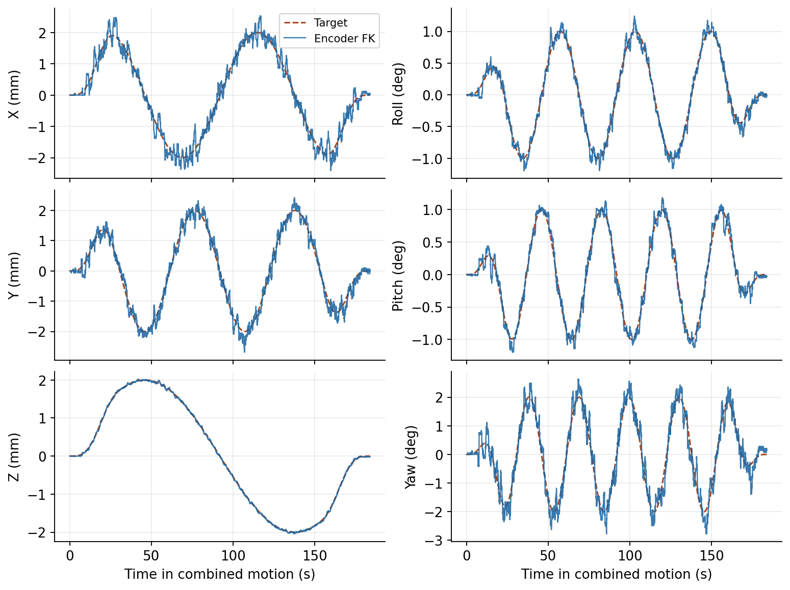
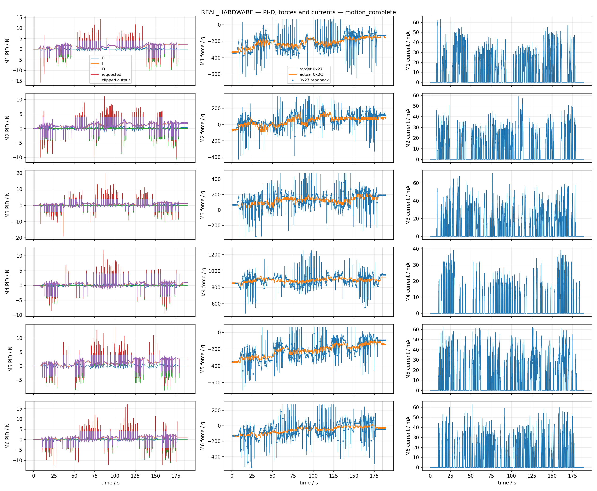

以前，上位机主要靠位置指令驱动六根滑杆。后来我先把受力反馈加进位置控制，再试着直接给六个执行器发力指令。这两种做法差在哪儿？直接给力，能让 Stewart 平台走完一条六自由度轨迹吗？

<!-- more -->

<figure style="display: flex; flex-direction: column; align-items: center; margin: 1.5em auto;">
  <video controls playsinline preload="metadata" width="360" height="640" style="display: block; width: 100%; max-width: 360px; height: auto; aspect-ratio: 9 / 16;">
    <source src="/images/14-stewart-5/native-force-control-demo-1_25x.mp4" type="video/mp4">
  </video>
  <figcaption style="position: static; display: block; margin: 12px auto 0; text-align: center;">原生轴向力控实机演示，画面以 1.25 倍速播放。<a href="/images/14-stewart-5/native-force-control-demo-original.mp4">查看原速视频</a>。</figcaption>
</figure>

## 一、位置伺服控制（Position）

给平台一个目标位姿，IK 算出六根滑杆各自该走到哪里。上位机把位置目标发给驱动器，由驱动器负责跟踪。这个办法已经能让平台走轨迹，也能接上[第四篇的姿态补偿](/2026/10/12/6-pus-stewart-4-attitude-stabilization/)。这次沿用上层的位姿计算和 IK，从执行器接到的指令开始改。

## 二、受力反馈辅助位置控制

单看滑杆的位置，还不知道这条支链承担了多少载荷。我先试了一个改动较小的办法：让受力反馈参与位置修正，驱动器继续做位置伺服。

对每一轴，上位机先根据位置误差算出受力需求，再与轴向受力反馈作比较。这次长测以带载静止时的读数为参考，取相对于该参考的受力变化。程序把受力差换算成这一拍的位置修正量，逐步累积，再加到该轴的 IK 参考上。六个轴各自算补偿，送到驱动器的仍然是六个位置目标。

11 月 8 日，我用这条路径做了约 24 分钟的真机运行。图 1 画出了每一时刻六轴中最大的名义位置误差和位置修正量。

<figure>
  
  <figcaption style="position: static; display: block; margin: 12px auto 0; text-align: center;">图 1. 每次有效更新取六轴绝对值中的最大值。上图是名义位置参考与反馈之差，下图是软件加在参考上的位置修正。</figcaption>
</figure>

两条曲线都在缓慢上升，最大位置误差为 1.130 mm，最大位置修正量为 1.118 mm。日志能看到偏移逐步累积，具体原因还不清楚。这也让我想试试另一条路，直接把力目标交给驱动器。

## 三、厂家原生轴向力控制

### 给的是力，怎么跟踪位置？

驱动器切到原生力控模式后，接收的是每个执行器的轴向力目标。要让上盘按轨迹走，上位机仍用 IK 算出六根滑杆的位置参考，再用编码器看各轴差了多少。位置误差回答的是“还差多远”，上位机据此决定“该多用多少力”。驱动器内部的原生力控负责执行这个力目标。六个执行器沿各自轴线施力，共同带动上盘。

### 平台停着，为什么还要给力？

即使上盘不动，六条支链也在承担平台和负载的重量。切换到原生力控时，我把各轴在当前负载下采集的保持力作为起点，记作 $F_{\mathrm{hold}}$。上位机用 PI-D 算出相对于这组保持力的增量。设 $e$ 是位置参考减去编码器位置，$\dot q$ 是实测滑杆速度，略去滤波和限幅，每轴的目标力可以写成

$$
F_{\mathrm{cmd}} = F_{\mathrm{hold}} + K_p e + K_i \int e \,\mathrm{d}t - K_d \dot q
$$

滑杆差得越多，P 项给出的修正越大。小偏差一直存在，I 项就逐步补上。D 项根据实际速度提供阻尼，作用方向与滑杆运动方向相反。三项加在保持力上，就得到这一拍的目标力。

| 方案 | 上位机怎么用反馈 | 驱动器接收什么 |
| --- | --- | --- |
| 位置伺服控制 | 用 IK 生成位置参考 | 位置目标 |
| 受力反馈辅助位置控制 | 用受力差修正位置参考 | 修正后的位置目标 |
| 厂家原生轴向力控制 | 用位置误差计算力增量 | 轴向力目标 |

## 四、原生轴向力控真机实验

### 升高 10 mm，再慢慢降回来

轴向力是驱动器接收的指令，上位机仍然可以安排一条位置轨迹。11 月 6 日的 Z 向实验用 100 秒升高 10 mm，顶部保持一小段，再用 100 秒返回。按每行的目标与编码器 FK 计算，Z 向 RMS 误差是 0.028 mm，峰值是 0.114 mm。

<figure>
  
  <figcaption style="position: static; display: block; margin: 12px auto 0; text-align: center;">图 2. Z 向往返。上图两条线大部分时候叠在一起，下图放大了 FK 与目标之间的差。</figcaption>
</figure>

同一天稍早的试跑到过顶部，却在保持阶段超时。图 2 来自后续完成上升、保持和返回的实机运行。

### 六个自由度一起走

接下来让 XYZ 同时走 ±2 mm，Roll 和 Pitch 走 ±1°，Yaw 走 ±2°。组合运动持续了约 184 秒，图中只画组合运动段。

<figure>
  
  <figcaption style="position: static; display: block; margin: 12px auto 0; text-align: center;">图 3. 六自由度组合运动。各子图以运动段首个目标为参考。</figcaption>
</figure>

图 3 右下角的 Yaw 最容易看出目标与估计位姿之间的差别，误差 RMS 约 0.319°，峰值约 1.099°。Z 向的 RMS 误差约 0.023 mm。这些数值来自六轴编码器的 FK 估算，平台的实际位姿精度还需独立测量。

### 看一眼力是怎么变化的

图 4 取自同一次组合运动。每行对应一根滑杆，左列是 PI-D 分项及输出，中列是目标力与轴向力反馈，右列是电流。厂家把力值写成克重，图中标作 g。换成牛顿时，把读数乘以 0.00980665 即可，相当于 1000 g 约为 9.81 N。以第四轴为例，运动段的目标力约为 4.74–12.27 N，反馈约为 7.94–9.19 N。

<figure>
  
  <figcaption style="position: static; display: block; margin: 12px auto 0; text-align: center;">图 4. 六轴控制输出与反馈。中列比较目标力和驱动器回报的轴向力。</figcaption>
</figure>

力目标和反馈的记录时刻不同，图 4 可以看两者随运动的变化，力环响应有多快还需单独测量。

## 五、现在能做到什么

三套方案都已整理成一键启动流程，可以在现有实机环境中演示。原生轴向力控这条链路已经走完了 10 mm 升降往返和六自由度组合轨迹。接下来，我会继续看这套力控在不同负载和实际任务里的表现。

## 源码仓库

- **[↗ GitHub · 6pus-bone-drill-position-control](https://github.com/LiorenYuhang/6pus-bone-drill-position-control)** 
  位置伺服控制。从逆运动学到六轴位置指令，打通平台的实机运动链路。

- **[↗ GitHub · 6pus-bone-drill-torque-control](https://github.com/LiorenYuhang/6pus-bone-drill-torque-control)** 
  受力反馈辅助位置控制。用轴向受力修正位置参考，记录了约 24 分钟的真机运行。

- **[↗ GitHub · 6pus-bone-drill-force-control](https://github.com/LiorenYuhang/6pus-bone-drill-force-control)** 
  厂家原生轴向力控制。六轴力目标直接交给驱动器，实机完成了 10 mm 升降往返和 184 秒六自由度组合轨迹。
